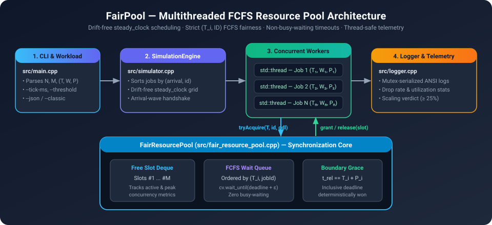
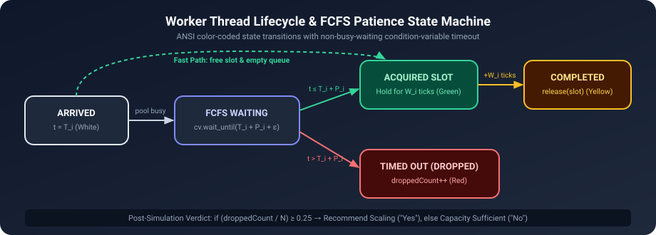
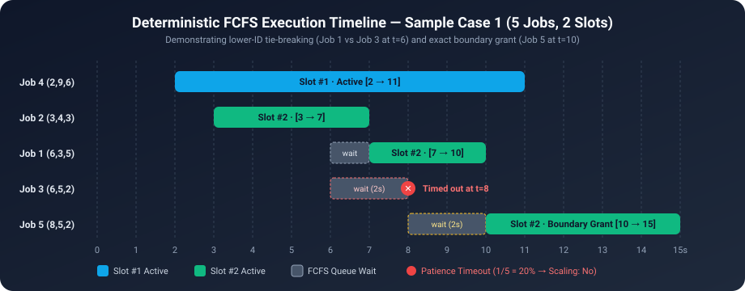

# FairPool — Multithreaded FCFS Resource Pool & Patience-Aware Concurrency Simulator

**FairPool** is a modular, production-grade C++20 multithreaded simulation engine for **bounded-resource allocation under patience constraints**. It models `N` concurrent worker threads competing for `M` shared resource slots with **strict First-Come, First-Served (FCFS) fairness**, **non-busy-waiting deadline timeouts**, **drift-free monotonic scheduling**, and **automated capacity-scaling telemetry**.

## Architecture Overview



FairPool cleanly separates concurrency primitives, simulation orchestration, thread-safe logging, and CLI parsing into a reusable C++20 library (`fairpool_core`) and executable (`fairpool`):

```text
fairpool/
├── include/fairpool/
│   ├── types.hpp                # Job, SimulationConfig, EventType, JobOutcome, SimulationStats
│   ├── fair_resource_pool.hpp   # Strict FCFS bounded-resource pool (mutex + cv, zero busy-wait)
│   ├── logger.hpp               # Mutex-serialized ANSI / Classic / JSON event logger
│   └── simulator.hpp            # Drift-free steady_clock multithreaded SimulationEngine
├── src/
│   ├── fair_resource_pool.cpp   # Ordered waiter queue, slot tracking, inclusive deadline logic
│   ├── logger.cpp               # Color-coded console & structured JSON output
│   ├── simulator.cpp            # Arrival-wave handshake, worker lifecycle, telemetry aggregation
│   └── main.cpp                 # CLI argument parser & workload loader
├── tests/
│   ├── test_fairpool.cpp        # 9 unit, boundary, edge-case & 24-thread stress tests
│   └── fixtures/                # Standard & edge-case workload inputs
├── assets/                      # Architecture, lifecycle, and Gantt SVG diagrams
├── docs/                        # Interactive GitHub Pages web simulator
├── .github/workflows/           # Cross-platform Ubuntu/macOS CI, ASan/UBSan/TSan & Pages
├── CMakeLists.txt               # Modern CMake build & CTest integration
└── Makefile                     # Quick build, test, and sanitizer targets
```

## Concurrency Model & Reliability Fixes

Naive semaphore implementations of bounded-resource pools suffer from three subtle concurrency flaws that FairPool explicitly solves:

| Failure Mode | Naive Semaphore Implementation | FairPool Solution |
|---|---|---|
| **Non-Deterministic FCFS** | `std::counting_semaphore` wakeup order is OS-dependent, allowing later arrivals to jump ahead of earlier waiters. | `FairResourcePool` maintains an explicit `(arrivalTick, jobId)` ordered waiter queue protected by a single `std::mutex` and `std::condition_variable`. |
| **Simultaneous Arrival Races** | Launching two threads at the same timestamp lets OS scheduling reorder tie-breakers (`id = 3` acquiring before `id = 1`). | `SimulationEngine` sorts by `(arrivalTime, id)` and uses an arrival-wave handshake so same-tick peers enter the pool in strict ascending ID order. |
| **Cumulative Clock Drift & Boundary Races** | Sequential `sleep_for(delta)` drifts over time, causing jobs whose patience expires at `t_release == T_i + P_i` to falsely time out by <1 ms. | Every arrival and release snaps to a shared `std::chrono::steady_clock` tick grid, paired with a calibrated boundary grace window (`ε = clamp(tickMs / 4, 2ms, 150ms)`) so exact-boundary handoffs succeed deterministically. |
| **Busy Waiting & Interleaved I/O** | Polling loops burn CPU; unlocked `std::cout` calls corrupt console lines. | Workers block cleanly in `cv.wait_until(...)` (0% spin CPU) and serialize output through `EventLogger`'s internal mutex with immediate flushing. |

### Worker Thread Lifecycle



## Execution Timeline Example

Below is the deterministic Gantt execution trace for `tests/fixtures/case1_low_drop.in` (`5 jobs`, `2 slots`):



1. **t = 2**: Job 4 arrives and immediately acquires **Slot #1** (`[2 → 11]`).
2. **t = 3**: Job 2 arrives and immediately acquires **Slot #2** (`[3 → 7]`).
3. **t = 6**: Job 1 and Job 3 arrive simultaneously. Both slots are busy; FCFS tie-breaking places **Job 1 ahead of Job 3**.
4. **t = 7**: Job 2 releases Slot #2; **Job 1** acquires it (`[7 → 10]`).
5. **t = 8**: Job 5 arrives (`deadline = 10`). **Job 3** reaches its patience limit (`6 + 2 = 8`) with no slot free and **times out**.
6. **t = 10**: Job 1 releases Slot #2; **Job 5** acquires it at its exact inclusive deadline (`8 + 2 = 10`) and runs `[10 → 15]`.
7. **Verdict**: `1 / 5` dropped (`20.0% < 25.0%`) → Capacity scaling recommended: **`No`**.

## Quick Start

### Prerequisites
- C++20 compiler (`g++ >= 10`, `clang++ >= 13`, or Apple Clang)
- `make` or `cmake >= 3.16`

### Build & Run with Make
```bash
make
./build/fairpool --input tests/fixtures/case1_low_drop.in --tick-ms 150
```

### Build & Test with CMake
```bash
cmake -S . -B build -DCMAKE_BUILD_TYPE=Release
cmake --build build --parallel
ctest --test-dir build --output-on-failure
```

### Run Memory & Thread Sanitizers
```bash
make sanitize-asan   # AddressSanitizer + UndefinedBehaviorSanitizer
make sanitize-tsan   # ThreadSanitizer (data-race verification)
```

## CLI Reference

```text
Usage: ./build/fairpool [OPTIONS]

Input (stdin or --input <file>):
  First line:   N M          (number of jobs, number of resource slots)
  Next N lines: T_i W_i P_i  (arrival tick, service ticks, patience ticks)

Options:
  --input <path>      Read workload from file instead of stdin
  --tick-ms <ms>      Milliseconds per logical tick (default: 1000)
  --threshold <0..1>  Drop-rate threshold for scaling recommendation (default: 0.25)
  --classic           Use legacy event log wording
  --no-color          Disable ANSI color escape codes
  --json              Output structured JSON telemetry summary
  --quiet             Suppress per-event log lines
  -h, --help          Show help message
```

### Example: Structured JSON Telemetry (`--json`)
```bash
./build/fairpool --input tests/fixtures/case1_low_drop.in --tick-ms 25 --json
```
```json
{
  "total_jobs": 5,
  "total_slots": 2,
  "served_jobs": 4,
  "dropped_jobs": 1,
  "drop_rate": 0.2000,
  "average_wait_ticks": 0.7500,
  "peak_utilization": 1.0000,
  "average_utilization": 0.7000,
  "makespan_ticks": 15,
  "scaling_recommended": false,
  "outcomes": [
    {"job_id": 1, "arrival_tick": 6, "start_tick": 7, "finish_tick": 10, "wait_ticks": 1, "slot_id": 2, "served": true},
    {"job_id": 2, "arrival_tick": 3, "start_tick": 3, "finish_tick": 7, "wait_ticks": 0, "slot_id": 2, "served": true},
    {"job_id": 3, "arrival_tick": 6, "start_tick": -1, "finish_tick": 8, "wait_ticks": 2, "slot_id": -1, "served": false},
    {"job_id": 4, "arrival_tick": 2, "start_tick": 2, "finish_tick": 11, "wait_ticks": 0, "slot_id": 1, "served": true},
    {"job_id": 5, "arrival_tick": 8, "start_tick": 10, "finish_tick": 15, "wait_ticks": 2, "slot_id": 2, "served": true}
  ]
}
```

## Testing & Continuous Integration

Every push and pull request runs automated GitHub Actions workflows across **Ubuntu (`ubuntu-latest`)** and **macOS (`macos-latest`)**:
- **9 unit & concurrency tests** (`tests/test_fairpool.cpp`): low/high drop rate cases, exact inclusive deadline boundary handoffs, simultaneous arrival tie-breaking, zero-patience (`P = 0`), zero-slot (`M = 0`), empty workloads (`N = 0`), classic format compatibility, JSON telemetry, and a **24-thread contention stress test**.
- **Sanitizer suite**: AddressSanitizer (`ASan`), UndefinedBehaviorSanitizer (`UBSan`), and ThreadSanitizer (`TSan`) confirming zero memory leaks, zero undefined behavior, and zero data races.

## Author

**Rajath Gadagkar** (`rajathgadagkar@gmail.com`)

## License

This project is licensed under the MIT License — see the [LICENSE](LICENSE) file for details.
